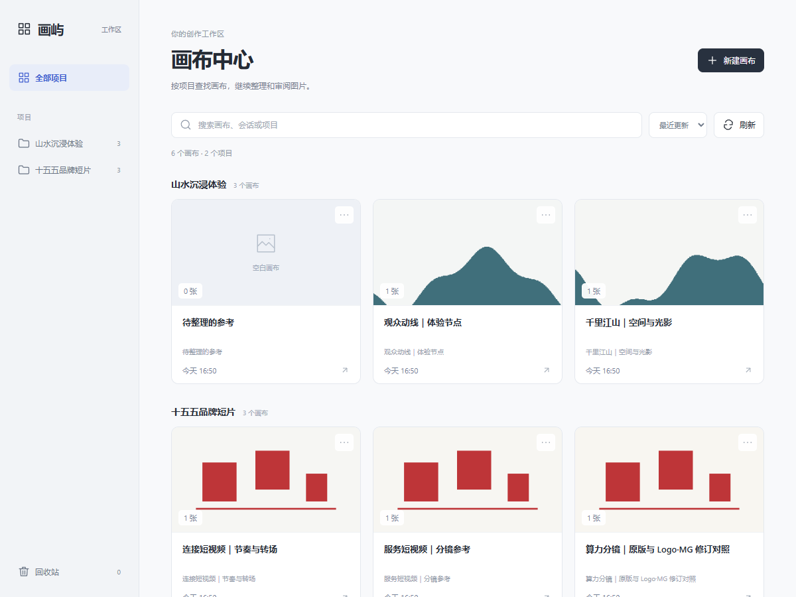

# 画屿

面向策划与视觉创作者的本地画布工作台。在 Codex 里管理分镜、生成图片和参考素材，按项目整理、连续审图，并保留修改版本。

画屿基于 [Codex Canvas](https://github.com/Xiangyu-CAS/codex-canvas) 二次开发。原作者的无限画布与图像编辑能力是本项目的基础；画屿在此基础上增加项目中心、跨会话素材导入、图片审阅与回收站，并修复面板重开、路径及版本错配问题。详见 [来源与致谢](UPSTREAM.md)。



## 主要功能

- **项目画布中心**：按项目分组、缩略图、搜索、排序，同项目画布快捷切换及返回中心。
- **连续审图**：双击大图预览，适应窗口、原始尺寸、缩放、拖动和左右切换。
- **图片与文字操作**：右键复制图片、另存原图、复制提示词；粘贴图片、文字，拖入多张图片。
- **跨会话导入**：选择部分或全部图片，保留提示词和来源，使用淡色来源框标明所属会话。
- **回收站**：右键移入、撤销、恢复；永久删除需要二次确认，进行中的操作受保护。
- **本地持久保存**：图片、状态与记录保存在项目中；面板重新打开后恢复画布。
- **图像工作流**：接收 Codex 的生成结果，支持局部修改、扩图、文字编辑、去背景与拆分图层等操作。

画布管理操作由本地程序完成，不需要为了切换、导入或删除额外发送聊天消息。图像生成仍由 Codex 及其可用模型完成，画屿本身不附送模型额度，也不承诺批量生成速度。

## 安装

把下面这段发给 Codex：

```text
请读取 https://github.com/xiewenhao436-png/HUA-YU/blob/main/INSTALL.md，安装“画屿”。保留已有画布和其他插件，并在安装后检查插件是否启用。
```

详细步骤、稳定版本及首版源码安装见 [INSTALL.md](INSTALL.md)。安装后在新聊天中选择“画屿”，或说明“打开画屿画布”。

## 平台状态

| 平台 | 状态 |
| --- | --- |
| Windows | 核心功能与受限 MCP 面板集成已验证。 |
| macOS | 已有跨平台实现，CI 配置覆盖核心与浏览器集成；本发布版尚无 Mac 原生 Codex 面板、剪贴板与触控板真机验收记录。 |
| Linux | 提供 Node / MCP 兼容实现与自动测试配置；具体桌面宿主支持以使用环境为准。 |

CI 实际结果请查看 [Actions](https://github.com/xiewenhao436-png/HUA-YU/actions)。配置了测试不代表测试已经通过；浏览器测试也不等于 Mac 原生面板已验收。

基础环境：支持 MCP App 的 Codex、Node.js 22.13 或更新版本，以及 Git。部分图像处理功能还需要 Python、Pillow、NumPy；OCR 是可选能力，不应阻止普通画布使用。Mac 使用 Homebrew / nvm 的用户，需确认从 Dock 启动的 Codex 能找到 Node。

## 旧画布兼容

画屿保留原版的 `canvas/` 目录、`codex-canvas.json`、会话画布编号与本地索引格式。安装和改名不会要求重新生成或迁移图片。请保留项目原有的整个 `canvas/` 目录。

新旧插件可能读取同一份画布。切换到画屿前先结束旧插件的编辑任务，并停用旧插件，避免同时编辑。旧聊天中保存的旧插件面板不会因改名自动变成新插件面板，可在画屿的画布中心重新选择已有画布。

## 隐私与数据

- 项目图片与画布状态保存在本地。跨会话索引只读取会话标题、工作目录等必要元数据，不读取完整聊天正文。
- 调用 Codex 生成、识别、修改图片或发送图片到聊天时，相关内容会进入该 Codex 工作流；这不是完全离线的模型服务。
- 更新检查与依赖安装会访问相应的软件仓库。远程图片来源也可能需要网络。
- 发布示例使用合成素材。请勿将个人密钥、会话数据或客户素材提交到公开仓库。

## 开发

```bash
npm ci
npm run build:app
npm test
npm run test:ui
npm run verify:release
```

UI 测试需要先安装 Chromium：`npx playwright install chromium`。核心、回收站、版本一致性和重启恢复测试均使用隔离的临时画布，不调用付费图像生成服务。

## 许可证与致谢

项目代码以 [MIT License](LICENSE) 发布，保留 Codex-Canvas Contributors 原版权声明。第三方依赖按各自许可证分发，见 [THIRD_PARTY_NOTICES.md](THIRD_PARTY_NOTICES.md)。

感谢 Codex Canvas 的原作者与贡献者。画屿是独立维护的派生项目，与原项目及 OpenAI 没有官方隶属关系。
